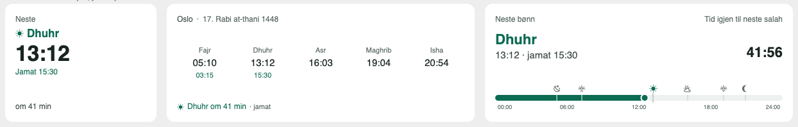
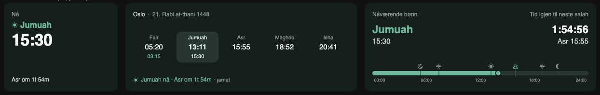

# Bønnetid for Home Assistant

Prayer times for Norway on your Home Assistant dashboard. Three Lovelace cards that match the
home screen widgets in the [Bønnetid](https://apps.apple.com/app/id6792056685) app, with the same
times, the same Jumuah rules and the same look in light and dark mode.




| Card | What it shows |
| --- | --- |
| `custom:bonnetid-small-card` | The prayer that is running, or the next one, with the time left |
| `custom:bonnetid-medium-card` | Today's five prayers, with jamat times under each one |
| `custom:bonnetid-timeline-card` | The day from 00:00 to 24:00 with a live countdown to the next prayer |

## Install

### HACS

1. HACS → three dots → **Custom repositories**
2. Add `https://github.com/zaimimr/bonnetid-card` with type **Dashboard**
3. Install **Bønnetid** and reload the browser

### Manual

1. Copy `bonnetid-card.js` to `config/www/`
2. Settings → Dashboards → three dots → **Resources** → add `/local/bonnetid-card.js` as a JavaScript module

## Configure

Add a card and search for **Bønnetid**. The editor lets you pick a place, a mosque and whether to
show jamat times. In YAML:

```yaml
type: custom:bonnetid-medium-card
location: NO0301
mosque: "971490896"
show_jamat: true
```

| Option | Default | Description |
| --- | --- | --- |
| `location` | | Kommune code, for example `NO0301` for Oslo. Optional when `mosque` is set |
| `mosque` | | Organisation number of a mosque. Adds jamat times and Jumuah on Fridays |
| `show_jamat` | `false` | Show the mosque's jamat times next to the adhan times |
| `asr_method` | `auto` | `irn`, `shadow_1x`, `shadow_2x` or `wusta`. `auto` uses the mosque, then the place |

On Fridays the Dhuhr slot reads **Jumuah** with the mosque's first congregation time, until half an
hour after the last one.

## Data

Times come from the same source as the app: the public Bønnetid API with prayer times from the
Islamic Council of Norway (IRN). The card reads it straight from the browser, so no integration
or sensors are needed. Times are shown in Norwegian time (`Europe/Oslo`).
